# Diagramas de Rede (CPM) — Tech Quest (PIM IV)

Este documento apresenta o **diagrama de rede** do projeto pelo Método do Caminho Crítico (CPM): para cada atividade, a predecessora, a duração, as datas de início e término mais cedo e mais tarde e a folga. As atividades com folga zero formam o **caminho crítico**, destacado em laranja nos diagramas.

São duas visões:

1. **Rede geral do projeto:** cada atividade é um requisito funcional (RF01 a RF12), mais as atividades de base (banco e estrutura da API) e os testes de integração. A duração está em **dias corridos**, de 31/08 a 14/10/2026.
2. **Rede de cada requisito:** as atividades necessárias para implementar o requisito em todas as camadas (banco, domínio, serviço, API, clientes e testes). A duração está em **horas de trabalho**.

> **Sobre as durações:** o projeto não registrou horas por requisito. As durações são **estimativas** distribuídas de forma coerente com o cronograma real das sprints (Sprint 01 a Sprint 04, de 31/08 a 14/10/2026). Em cada requisito, o caminho crítico em horas corresponde à duração dele na rede geral, considerando 1 dia = 8 horas.

**Rede x sprints:** as sprints organizaram o trabalho por camada (banco, API, Web, Desktop e Mobile); a rede organiza o mesmo trabalho por requisito. Por isso o período previsto de cada requisito na rede geral atravessa mais de uma sprint.

**Como ler os diagramas:** cada círculo é uma atividade. O número em cada seta é a duração da atividade de onde a seta sai, como no modelo apresentado em aula. As atividades e setas em laranja estão no caminho crítico.

**Legenda das colunas:** *Início cedo* e *Término cedo* são o primeiro momento em que a atividade pode começar e terminar; *Início tarde* e *Término tarde* são o último momento possível sem atrasar o projeto; *Folga* = Início tarde − Início cedo.

---

## Sumário

- [1. Rede geral do projeto](#1-rede-geral-do-projeto)

- [2. RF01 — Gerir usuários](#2-rf01--gerir-usuários)
- [3. RF02 — Autenticar acesso](#3-rf02--autenticar-acesso)
- [4. RF03 — Gerir cursos](#4-rf03--gerir-cursos)
- [5. RF04 — Moderar publicações](#5-rf04--moderar-publicações)
- [6. RF05 — Monitorar progresso](#6-rf05--monitorar-progresso)
- [7. RF06 — Avaliar conhecimento](#7-rf06--avaliar-conhecimento)
- [8. RF07 — Emitir certificados](#8-rf07--emitir-certificados)
- [9. RF08 — Atribuir medalhas](#9-rf08--atribuir-medalhas)
- [10. RF09 — Protocolar chamados](#10-rf09--protocolar-chamados)
- [11. RF10 — Interagir no suporte](#11-rf10--interagir-no-suporte)
- [12. RF11 — Auditar ações](#12-rf11--auditar-ações)
- [13. RF12 — Extrair relatórios](#13-rf12--extrair-relatórios)
- [14. Resumo dos caminhos críticos](#14-resumo-dos-caminhos-críticos)

---

## 1. Rede geral do projeto

**Caminho crítico = 45 dias** (31/08 a 14/10/2026)

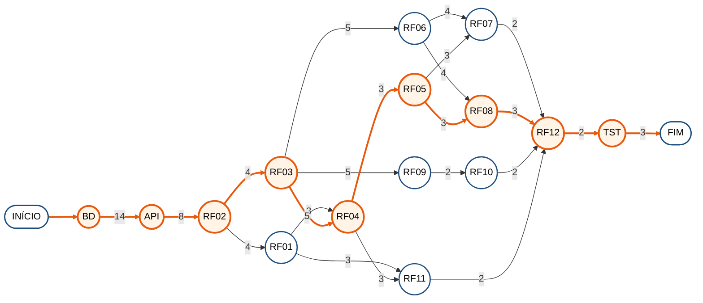

| Atividade | Descrição | Predecessora | Duração (dias) | Início cedo | Término cedo | Início tarde | Término tarde | Folga | Período previsto |
| :---: | :--- | :---: | :---: | :---: | :---: | :---: | :---: | :---: | :---: |
| **BD** | Banco de dados: modelo físico, procedure, trigger e Azure SQL (PB01 a PB03) | — | 14 | 0 | 14 | 0 | 14 | **0** | 31/08 a 13/09 |
| **API** | Estrutura da API .NET em camadas e conexão com o banco (PB04, PB05) | BD | 8 | 14 | 22 | 14 | 22 | **0** | 14/09 a 21/09 |
| **RF02** | Autenticar acesso | API | 4 | 22 | 26 | 22 | 26 | **0** | 22/09 a 25/09 |
| RF01 | Gerir usuários | RF02 | 3 | 26 | 29 | 28 | 31 | 2 | 26/09 a 28/09 |
| **RF03** | Gerir cursos | RF02 | 5 | 26 | 31 | 26 | 31 | **0** | 26/09 a 30/09 |
| **RF04** | Moderar publicações | RF01, RF03 | 3 | 31 | 34 | 31 | 34 | **0** | 01/10 a 03/10 |
| RF06 | Avaliar conhecimento | RF03 | 4 | 31 | 35 | 33 | 37 | 2 | 01/10 a 04/10 |
| **RF05** | Monitorar progresso | RF04 | 3 | 34 | 37 | 34 | 37 | **0** | 04/10 a 06/10 |
| RF07 | Emitir certificados | RF05, RF06 | 2 | 37 | 39 | 38 | 40 | 1 | 07/10 a 08/10 |
| **RF08** | Atribuir medalhas | RF05, RF06 | 3 | 37 | 40 | 37 | 40 | **0** | 07/10 a 09/10 |
| RF09 | Protocolar chamados | RF03 | 2 | 31 | 33 | 36 | 38 | 5 | 01/10 a 02/10 |
| RF10 | Interagir no suporte | RF09 | 2 | 33 | 35 | 38 | 40 | 5 | 03/10 a 04/10 |
| RF11 | Auditar ações | RF01, RF04 | 2 | 34 | 36 | 38 | 40 | 4 | 04/10 a 05/10 |
| **RF12** | Extrair relatórios | RF07, RF08, RF10, RF11 | 2 | 40 | 42 | 40 | 42 | **0** | 10/10 a 11/10 |
| **TST** | Testes de integração ponta a ponta (PB10) | RF12 | 3 | 42 | 45 | 42 | 45 | **0** | 12/10 a 14/10 |

**Caminho crítico:** BD → API → RF02 → RF03 → RF04 → RF05 → RF08 → RF12 → TST = 14 + 8 + 4 + 5 + 3 + 3 + 3 + 2 + 3 = **45 dias**.

**Leitura:** o banco e a estrutura da API são pré-requisito de todos os requisitos, por isso abrem o caminho crítico. Depois da autenticação (RF02), o projeto se divide em frentes paralelas. O caminho crítico passa por cursos, moderação, progresso e medalhas, porque o painel de relatórios (RF12) só pode ser concluído quando todas as funcionalidades que ele resume estão prontas. As atividades com folga, como RF01 (2 dias), RF06 (2 dias), RF07 (1 dias), RF09 (5 dias), podiam atrasar até o valor da folga sem mover a data final.

---

## 2. RF01 — Gerir usuários

Cadastrar, consultar, ativar e desativar contas; cada usuário edita o próprio perfil.

**Caminho crítico = 24 horas** (3 dias de trabalho)

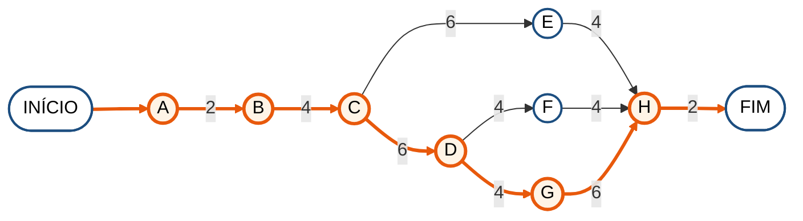

| Atividade | Descrição | Predecessora | Duração (horas) | Início cedo | Término cedo | Início tarde | Término tarde | Folga |
| :---: | :--- | :---: | :---: | :---: | :---: | :---: | :---: | :---: |
| **A** | Script: colunas de contato em Usuario | — | 2 | 0 | 2 | 0 | 2 | **0** |
| **B** | Regras de criação (e-mail único, senha mínima, especialização) e desativação | A | 4 | 2 | 6 | 2 | 6 | **0** |
| **C** | AdminService e ContaService com repositório de usuários | B | 6 | 6 | 12 | 6 | 12 | **0** |
| **D** | Endpoints /api/admin/usuarios e /api/perfil | C | 4 | 12 | 16 | 12 | 16 | **0** |
| E | Testes unitários de gestão de usuários | C | 4 | 12 | 16 | 18 | 22 | 6 |
| F | Telas Web: usuários, criar usuário e perfil | D | 4 | 16 | 20 | 18 | 22 | 2 |
| **G** | Tela Desktop Usuários com senha gerada | D | 6 | 16 | 22 | 16 | 22 | **0** |
| **H** | Teste de integração do requisito | E, F, G | 2 | 22 | 24 | 22 | 24 | **0** |

**Caminho crítico:** A → B → C → D → G → H = 2 + 4 + 6 + 4 + 6 + 2 = **24 horas**.

---

## 3. RF02 — Autenticar acesso

Validar e-mail e senha, emitir o token JWT e controlar o acesso por papel.

**Caminho crítico = 32 horas** (4 dias de trabalho)

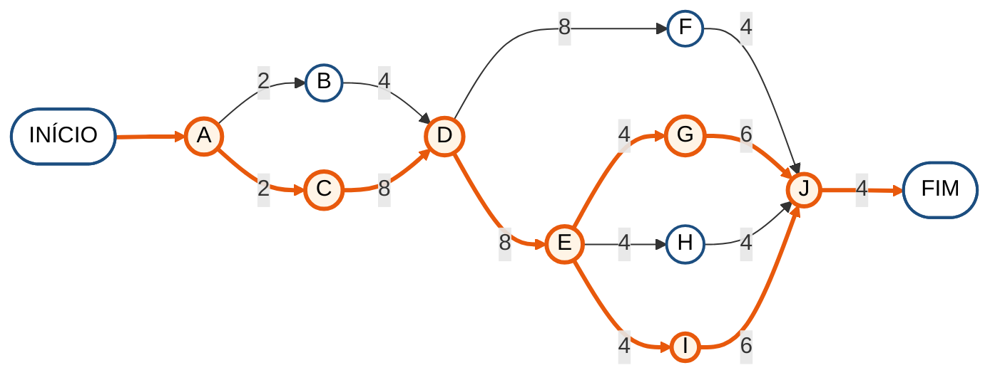

| Atividade | Descrição | Predecessora | Duração (horas) | Início cedo | Término cedo | Início tarde | Término tarde | Folga |
| :---: | :--- | :---: | :---: | :---: | :---: | :---: | :---: | :---: |
| **A** | Ajuste do campo de senha (VARCHAR 255) para hash | — | 2 | 0 | 2 | 0 | 2 | **0** |
| B | BCryptHashService (fator 11) | A | 4 | 2 | 6 | 6 | 10 | 4 |
| **C** | JwtTokenService e configuração do JWT na API | A | 8 | 2 | 10 | 2 | 10 | **0** |
| **D** | AutenticacaoService (login e cadastro) | B, C | 8 | 10 | 18 | 10 | 18 | **0** |
| **E** | AuthController e [Authorize] por papel | D | 4 | 18 | 22 | 18 | 22 | **0** |
| F | Testes unitários de autenticação | D | 4 | 18 | 22 | 24 | 28 | 6 |
| **G** | Login e cadastro Web (api.js e sessionStorage) | E | 6 | 22 | 28 | 22 | 28 | **0** |
| H | Login Desktop (somente Administrador) | E | 4 | 22 | 26 | 24 | 28 | 2 |
| **I** | Login Mobile (SecureStore) | E | 6 | 22 | 28 | 22 | 28 | **0** |
| **J** | Teste de integração do requisito | F, G, H, I | 4 | 28 | 32 | 28 | 32 | **0** |

**Caminho crítico:** A → C → D → E → G → J | A → C → D → E → I → J = 2 + 8 + 8 + 4 + 6 + 4 = **32 horas**.

---

## 4. RF03 — Gerir cursos

Criar e editar cursos, aulas, provas e questões.

**Caminho crítico = 40 horas** (5 dias de trabalho)

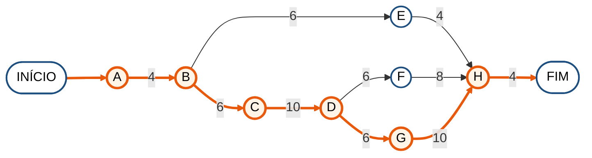

| Atividade | Descrição | Predecessora | Duração (horas) | Início cedo | Término cedo | Início tarde | Término tarde | Folga |
| :---: | :--- | :---: | :---: | :---: | :---: | :---: | :---: | :---: |
| **A** | Script: colunas de Curso, Material, Prova, Questao e Alternativas | — | 4 | 0 | 4 | 0 | 4 | **0** |
| **B** | Entidades e regras (edição só em Rascunho/Rejeitado, RegrasQuestao) | A | 6 | 4 | 10 | 4 | 10 | **0** |
| **C** | TutorService: cursos, aulas, prova e questões | B | 10 | 10 | 20 | 10 | 20 | **0** |
| **D** | Endpoints /api/tutor | C | 6 | 20 | 26 | 20 | 26 | **0** |
| E | Testes unitários das regras de curso e questão | B | 4 | 10 | 14 | 32 | 36 | 22 |
| F | Telas Web do tutor: criar e editar curso | D | 8 | 26 | 34 | 28 | 36 | 2 |
| **G** | Telas Mobile do tutor: editor, material e questão | D | 10 | 26 | 36 | 26 | 36 | **0** |
| **H** | Teste de integração do requisito | E, F, G | 4 | 36 | 40 | 36 | 40 | **0** |

**Caminho crítico:** A → B → C → D → G → H = 4 + 6 + 10 + 6 + 10 + 4 = **40 horas**.

---

## 5. RF04 — Moderar publicações

Submeter, revisar, aprovar ou rejeitar cursos antes da publicação.

**Caminho crítico = 24 horas** (3 dias de trabalho)

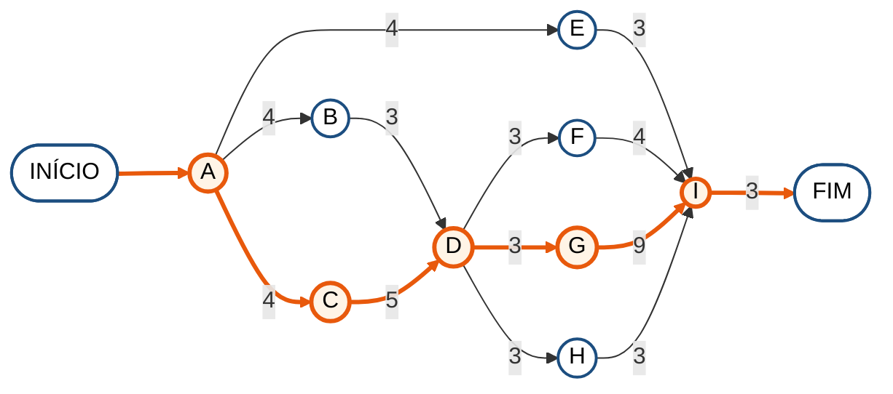

| Atividade | Descrição | Predecessora | Duração (horas) | Início cedo | Término cedo | Início tarde | Término tarde | Folga |
| :---: | :--- | :---: | :---: | :---: | :---: | :---: | :---: | :---: |
| **A** | Máquina de estados FluxoPublicacaoCurso | — | 4 | 0 | 4 | 0 | 4 | **0** |
| B | Submissão do curso no TutorService | A | 3 | 4 | 7 | 6 | 9 | 2 |
| **C** | Aprovação e rejeição no AdminService (log e motivo ao tutor) | A | 5 | 4 | 9 | 4 | 9 | **0** |
| **D** | Endpoints de submissão, aprovação e rejeição | B, C | 3 | 9 | 12 | 9 | 12 | **0** |
| E | Testes unitários do fluxo de publicação | A | 3 | 4 | 7 | 18 | 21 | 14 |
| F | Tela Web de aprovações | D | 4 | 12 | 16 | 17 | 21 | 5 |
| **G** | Desktop: aprovações, revisão do curso e selo de pendências | D | 9 | 12 | 21 | 12 | 21 | **0** |
| H | Mobile: submissão e aviso de curso rejeitado | D | 3 | 12 | 15 | 18 | 21 | 6 |
| **I** | Teste de integração do requisito | E, F, G, H | 3 | 21 | 24 | 21 | 24 | **0** |

**Caminho crítico:** A → C → D → G → I = 4 + 5 + 3 + 9 + 3 = **24 horas**.

---

## 6. RF05 — Monitorar progresso

Matricular, registrar a leitura das aulas e calcular o percentual de conclusão.

**Caminho crítico = 24 horas** (3 dias de trabalho)

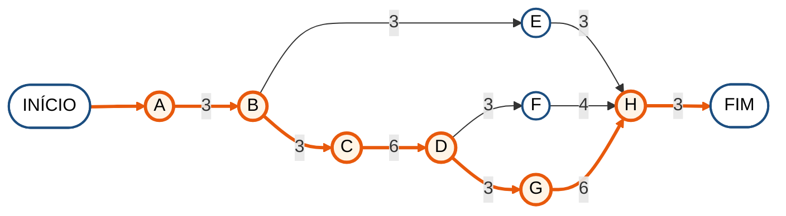

| Atividade | Descrição | Predecessora | Duração (horas) | Início cedo | Término cedo | Início tarde | Término tarde | Folga |
| :---: | :--- | :---: | :---: | :---: | :---: | :---: | :---: | :---: |
| **A** | Mapeamento de Progresso e Historico (matrícula) | — | 3 | 0 | 3 | 0 | 3 | **0** |
| **B** | Regra do percentual de conclusão | A | 3 | 3 | 6 | 3 | 6 | **0** |
| **C** | ProgressoService (matrícula e progresso que não retrocede) | B | 6 | 6 | 12 | 6 | 12 | **0** |
| **D** | Endpoints de matrícula e progresso | C | 3 | 12 | 15 | 12 | 15 | **0** |
| E | Testes unitários de progresso | B | 3 | 6 | 9 | 18 | 21 | 12 |
| F | Telas Web de curso e aula | D | 4 | 15 | 19 | 17 | 21 | 2 |
| **G** | Telas Mobile de curso e aula com leitura parcial | D | 6 | 15 | 21 | 15 | 21 | **0** |
| **H** | Teste de integração do requisito | E, F, G | 3 | 21 | 24 | 21 | 24 | **0** |

**Caminho crítico:** A → B → C → D → G → H = 3 + 3 + 6 + 3 + 6 + 3 = **24 horas**.

---

## 7. RF06 — Avaliar conhecimento

Aplicar a prova sem gabarito, corrigir no servidor e registrar a tentativa.

**Caminho crítico = 32 horas** (4 dias de trabalho)

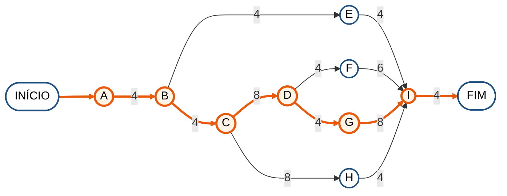

| Atividade | Descrição | Predecessora | Duração (horas) | Início cedo | Término cedo | Início tarde | Término tarde | Folga |
| :---: | :--- | :---: | :---: | :---: | :---: | :---: | :---: | :---: |
| **A** | Mapeamento da prova e DTO sem gabarito | — | 4 | 0 | 4 | 0 | 4 | **0** |
| **B** | Cálculo da nota e regra de aprovação | A | 4 | 4 | 8 | 4 | 8 | **0** |
| **C** | ProvaService: obter prova e corrigir tentativa | B | 8 | 8 | 16 | 8 | 16 | **0** |
| **D** | Endpoints /api/provas | C | 4 | 16 | 20 | 16 | 20 | **0** |
| E | Testes unitários de correção | B | 4 | 8 | 12 | 24 | 28 | 16 |
| F | Telas Web de prova e resultado | D | 6 | 20 | 26 | 22 | 28 | 2 |
| **G** | Telas Mobile de prova e resultado | D | 8 | 20 | 28 | 20 | 28 | **0** |
| H | Procedure SP_RelatorioDesempenhoEstudante e Minhas provas | C | 4 | 16 | 20 | 24 | 28 | 8 |
| **I** | Teste de integração do requisito | E, F, G, H | 4 | 28 | 32 | 28 | 32 | **0** |

**Caminho crítico:** A → B → C → D → G → I = 4 + 4 + 8 + 4 + 8 + 4 = **32 horas**.

---

## 8. RF07 — Emitir certificados

Gerar o certificado com código de autenticidade ao concluir o curso.

**Caminho crítico = 16 horas** (2 dias de trabalho)

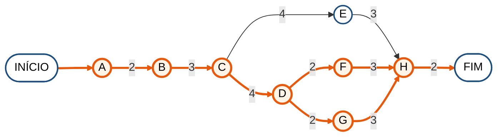

| Atividade | Descrição | Predecessora | Duração (horas) | Início cedo | Término cedo | Início tarde | Término tarde | Folga |
| :---: | :--- | :---: | :---: | :---: | :---: | :---: | :---: | :---: |
| **A** | Certificado com código GUID gerado pelo banco | — | 2 | 0 | 2 | 0 | 2 | **0** |
| **B** | Regra de conclusão do curso | A | 3 | 2 | 5 | 2 | 5 | **0** |
| **C** | ConclusaoCursoService com os dois gatilhos | B | 4 | 5 | 9 | 5 | 9 | **0** |
| **D** | Endpoints de certificados (perfil e validação pública) | C | 2 | 9 | 11 | 9 | 11 | **0** |
| E | Testes do serviço de conclusão | C | 3 | 9 | 12 | 11 | 14 | 2 |
| **F** | Tela Web do certificado (imprimir e validar) | D | 3 | 11 | 14 | 11 | 14 | **0** |
| **G** | Tela Mobile de certificados (copiar e compartilhar) | D | 3 | 11 | 14 | 11 | 14 | **0** |
| **H** | Teste de integração do requisito | E, F, G | 2 | 14 | 16 | 14 | 16 | **0** |

**Caminho crítico:** A → B → C → D → F → H | A → B → C → D → G → H = 2 + 3 + 4 + 2 + 3 + 2 = **16 horas**.

---

## 9. RF08 — Atribuir medalhas

Conceder medalhas automáticas e manuais e calcular XP e nível.

**Caminho crítico = 24 horas** (3 dias de trabalho)

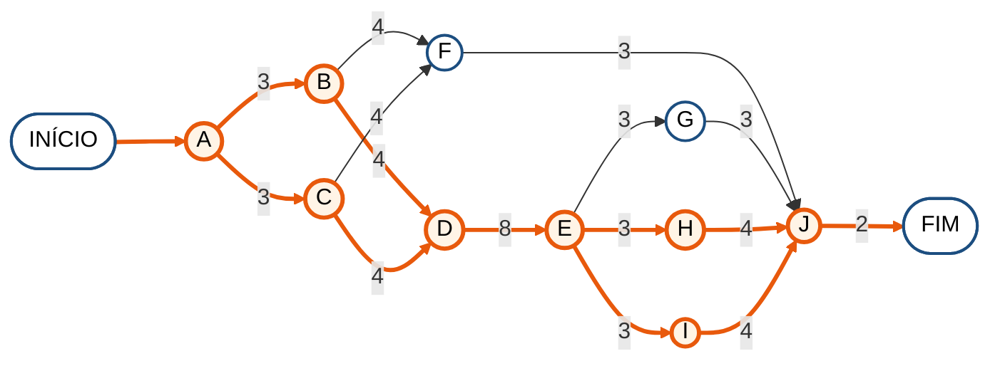

| Atividade | Descrição | Predecessora | Duração (horas) | Início cedo | Término cedo | Início tarde | Término tarde | Folga |
| :---: | :--- | :---: | :---: | :---: | :---: | :---: | :---: | :---: |
| **A** | Catálogo de medalhas (descrição e carga inicial) | — | 3 | 0 | 3 | 0 | 3 | **0** |
| **B** | RegrasGamificacao (XP e nível) | A | 4 | 3 | 7 | 3 | 7 | **0** |
| **C** | RegrasMedalhas (critérios automáticos) | A | 4 | 3 | 7 | 3 | 7 | **0** |
| **D** | ConquistaService e GamificacaoService | B, C | 8 | 7 | 15 | 7 | 15 | **0** |
| **E** | Endpoints de conquistas, concessão e catálogo | D | 3 | 15 | 18 | 15 | 18 | **0** |
| F | Testes unitários das regras | B, C | 3 | 7 | 10 | 19 | 22 | 12 |
| G | Tela Web de conquistas | E | 3 | 18 | 21 | 19 | 22 | 1 |
| **H** | Tela Desktop de medalhas | E | 4 | 18 | 22 | 18 | 22 | **0** |
| **I** | Telas Mobile de conquistas e concessão | E | 4 | 18 | 22 | 18 | 22 | **0** |
| **J** | Teste de integração do requisito | F, G, H, I | 2 | 22 | 24 | 22 | 24 | **0** |

**Caminho crítico:** A → B → D → E → H → J | A → B → D → E → I → J | A → C → D → E → H → J | A → C → D → E → I → J = 3 + 4 + 8 + 3 + 4 + 2 = **24 horas**.

---

## 10. RF09 — Protocolar chamados

Abrir chamados técnicos ou de dúvida encaminhados ao responsável.

**Caminho crítico = 16 horas** (2 dias de trabalho)

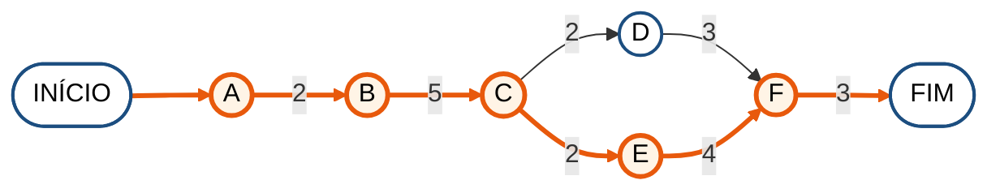

| Atividade | Descrição | Predecessora | Duração (horas) | Início cedo | Término cedo | Início tarde | Término tarde | Folga |
| :---: | :--- | :---: | :---: | :---: | :---: | :---: | :---: | :---: |
| **A** | Script: curso no chamado e índice | — | 2 | 0 | 2 | 0 | 2 | **0** |
| **B** | ChamadoService: abertura e roteamento | A | 5 | 2 | 7 | 2 | 7 | **0** |
| **C** | Endpoints /api/chamados | B | 2 | 7 | 9 | 7 | 9 | **0** |
| D | Tela Web de suporte | C | 3 | 9 | 12 | 10 | 13 | 1 |
| **E** | Tela Mobile de suporte | C | 4 | 9 | 13 | 9 | 13 | **0** |
| **F** | Teste de integração do requisito | D, E | 3 | 13 | 16 | 13 | 16 | **0** |

**Caminho crítico:** A → B → C → E → F = 2 + 5 + 2 + 4 + 3 = **16 horas**.

---

## 11. RF10 — Interagir no suporte

Responder, alterar a situação e encerrar os chamados.

**Caminho crítico = 16 horas** (2 dias de trabalho)

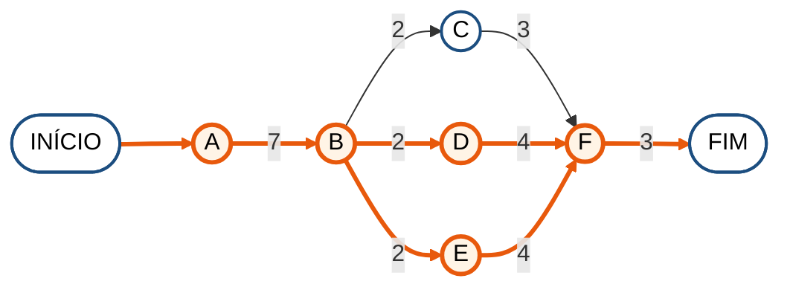

| Atividade | Descrição | Predecessora | Duração (horas) | Início cedo | Término cedo | Início tarde | Término tarde | Folga |
| :---: | :--- | :---: | :---: | :---: | :---: | :---: | :---: | :---: |
| **A** | ChamadoService: responder, situação e encerramento | — | 7 | 0 | 7 | 0 | 7 | **0** |
| **B** | Endpoints de resposta e situação | A | 2 | 7 | 9 | 7 | 9 | **0** |
| C | Telas Web de dúvidas e chamados | B | 3 | 9 | 12 | 10 | 13 | 1 |
| **D** | Tela Desktop de chamados técnicos | B | 4 | 9 | 13 | 9 | 13 | **0** |
| **E** | Tela Mobile de dúvidas do tutor | B | 4 | 9 | 13 | 9 | 13 | **0** |
| **F** | Teste de integração do requisito | C, D, E | 3 | 13 | 16 | 13 | 16 | **0** |

**Caminho crítico:** A → B → D → F | A → B → E → F = 7 + 2 + 4 + 3 = **16 horas**.

---

## 12. RF11 — Auditar ações

Registrar e consultar os logs das ações críticas.

**Caminho crítico = 16 horas** (2 dias de trabalho)

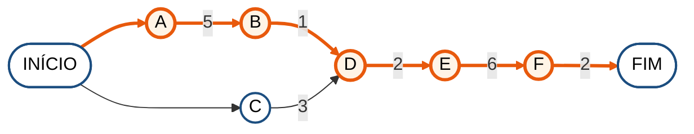

| Atividade | Descrição | Predecessora | Duração (horas) | Início cedo | Término cedo | Início tarde | Término tarde | Folga |
| :---: | :--- | :---: | :---: | :---: | :---: | :---: | :---: | :---: |
| **A** | Trigger TRG_Auditoria_StatusUsuario | — | 5 | 0 | 5 | 0 | 5 | **0** |
| **B** | Mapeamento com HasTrigger no Entity Framework | A | 1 | 5 | 6 | 5 | 6 | **0** |
| C | Log das avaliações de curso no AdminService | — | 3 | 0 | 3 | 3 | 6 | 3 |
| **D** | Endpoint /api/admin/logs | B, C | 2 | 6 | 8 | 6 | 8 | **0** |
| **E** | Tela Desktop de logs | D | 6 | 8 | 14 | 8 | 14 | **0** |
| **F** | Teste de integração do requisito | E | 2 | 14 | 16 | 14 | 16 | **0** |

**Caminho crítico:** A → B → D → E → F = 5 + 1 + 2 + 6 + 2 = **16 horas**.

---

## 13. RF12 — Extrair relatórios

Painel de indicadores e relatório de desempenho do estudante.

**Caminho crítico = 16 horas** (2 dias de trabalho)

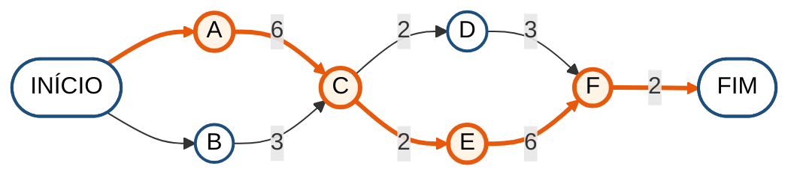

| Atividade | Descrição | Predecessora | Duração (horas) | Início cedo | Término cedo | Início tarde | Término tarde | Folga |
| :---: | :--- | :---: | :---: | :---: | :---: | :---: | :---: | :---: |
| **A** | Indicadores do painel no AdminService | — | 6 | 0 | 6 | 0 | 6 | **0** |
| B | Leitura da procedure no RelatorioRepository | — | 3 | 0 | 3 | 3 | 6 | 3 |
| **C** | Endpoints de resumo e desempenho | A, B | 2 | 6 | 8 | 6 | 8 | **0** |
| D | Telas Web de painel e relatórios | C | 3 | 8 | 11 | 11 | 14 | 3 |
| **E** | Tela Desktop Painel | C | 6 | 8 | 14 | 8 | 14 | **0** |
| **F** | Teste de integração do requisito | D, E | 2 | 14 | 16 | 14 | 16 | **0** |

**Caminho crítico:** A → C → E → F = 6 + 2 + 6 + 2 = **16 horas**.

---

## 14. Resumo dos caminhos críticos

| Requisito | Nome | Caminho crítico | Duração (horas) | Duração na rede geral (dias) |
| :---: | :--- | :--- | :---: | :---: |
| RF01 | Gerir usuários | A → B → C → D → G → H | 24 | 3 |
| RF02 | Autenticar acesso | A → C → D → E → G → J | A → C → D → E → I → J | 32 | 4 |
| RF03 | Gerir cursos | A → B → C → D → G → H | 40 | 5 |
| RF04 | Moderar publicações | A → C → D → G → I | 24 | 3 |
| RF05 | Monitorar progresso | A → B → C → D → G → H | 24 | 3 |
| RF06 | Avaliar conhecimento | A → B → C → D → G → I | 32 | 4 |
| RF07 | Emitir certificados | A → B → C → D → F → H | A → B → C → D → G → H | 16 | 2 |
| RF08 | Atribuir medalhas | A → B → D → E → H → J | A → B → D → E → I → J | A → C → D → E → H → J | A → C → D → E → I → J | 24 | 3 |
| RF09 | Protocolar chamados | A → B → C → E → F | 16 | 2 |
| RF10 | Interagir no suporte | A → B → D → F | A → B → E → F | 16 | 2 |
| RF11 | Auditar ações | A → B → D → E → F | 16 | 2 |
| RF12 | Extrair relatórios | A → C → E → F | 16 | 2 |

Em praticamente todos os requisitos, o caminho crítico atravessa todas as camadas: **banco → domínio → serviço → API → cliente → teste de integração**. Isso reflete a arquitetura em camadas do projeto: um cliente só pode consumir uma rota depois que a regra de negócio e o serviço que ela usa estão prontos. Os testes unitários quase sempre têm folga, porque podem ser escritos em paralelo com a API e com as telas.
