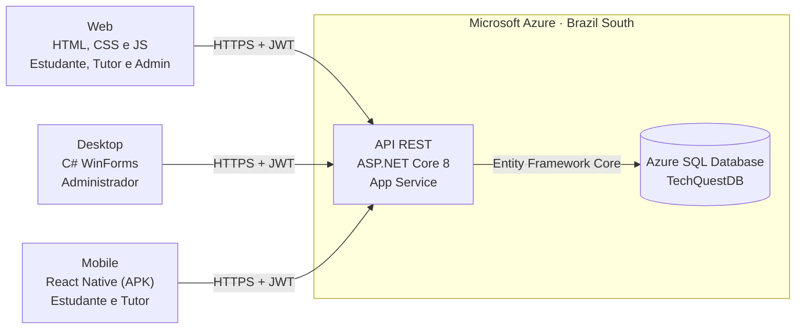

# Pim 4

# Desafio
Desenvolver o projeto de uma plataforma web de avaliação e apoio à aprendizagem para uma empresa fictícia de tecnologia educacional, expandindo para as versões Desktop e Mobile e conectando com um banco de dados.

# Status do Projeto
Em desenvolvimento

# Documentação

| Documento | Conteúdo |
| :--- | :--- |
| [`Docs/README.md`](Docs/README.md) | Requisitos detalhados, regras de negócio e registro de decisões de arquitetura (ADR) |
| [`SQL/README.md`](SQL/README.md) | Dicionário de dados e instruções para criar o banco |
| `Diagramas/DiagramasUML.asta` | Casos de uso, classes (BCE), sequência, MER e DER |
| `Docs/Sprint Planning.docx` | Planejamento detalhado de cada sprint |

# Como Executar

A solução tem um banco e uma API publicados no Azure, consumidos por três aplicações. Nenhuma aplicação acessa o banco diretamente.

Como a API e o banco já estão no Azure, **cada aplicação pode ser executada sozinha**, sem subir o back-end localmente.

| Aplicação | Como executar | Detalhes |
| :--- | :--- | :--- |
| **Web** | Na pasta `Web`, rode `python -m http.server 8080` e acesse `http://localhost:8080` (ou use o Live Server do VS Code). | [`Web/README.md`](Web/README.md) |
| **Desktop** | Abra `Desktop/TechQuest.Desktop.slnx` no Visual Studio 2022, defina `TechQuest.Desktop.UI` como projeto de inicialização e pressione F5. Requer Windows. | [`Desktop/README.md`](Desktop/README.md) |
| **Mobile** | Baixe o APK na [release mais recente](https://github.com/WillSennaa/Pim-4/releases/latest) e instale no Android. Para compilar: `npm install` e `npm run apk` na pasta `Mobile`. | [`Mobile/README.md`](Mobile/README.md) |
| **API** (opcional) | Configure os User Secrets (connection string e chave JWT), abra `BackEnd/TechQuest.slnx` e pressione F5. O Swagger abre em `/swagger`. | [`BackEnd/README.md`](BackEnd/README.md) |
| **Banco** (opcional) | Para criar um banco novo, rode `SQL/BD Pim 4/01_estrutura.sql` e depois `02_dados_demonstracao.sql`. | [`SQL/README.md`](SQL/README.md) |

**API publicada:** https://tqbackendapi-cpb2edg0gxcsfggz.brazilsouth-01.azurewebsites.net/swagger

### Contas de demonstração

| Perfil | E-mail | Senha | Onde acessar |
| :--- | :--- | :--- | :--- |
| Estudante | `felipe123@gmail.com` | `aluno123@` | Web e Mobile |
| Tutor | `tutor123@gmail.com` | `tutor123@` | Web e Mobile |
| Administrador | `admin123@gmail.com` | `admin123@` | Web e Desktop |

> O banco usa o tier serverless do Azure, que pausa quando fica sem uso. O primeiro acesso depois de um tempo parado pode levar algumas dezenas de segundos.

### Product Backlog

| ID | Item / Funcionalidade | Prioridade | Requisito | Estimativa (Pts) | Sprint | Situação |
| :---: | :--- | :---: | :---: | :---: | :---: | :---: |
| **PB01** | Mapear e criar o modelo físico no SQL Server | ALTA | Infra DB | 8 | 01 | **CONCLUÍDO** |
| **PB02** | Implementar Stored Procedures e Triggers no banco SQL | ALTA | RF11, RF12 | 5 | 01 | **CONCLUÍDO** |
| **PB03** | Configurar e hospedar o banco SQL Server em nuvem (Azure) | ALTA | Infra Cloud | 3 | 01 | **CONCLUÍDO** |
| **PB04** | Estruturar projeto Backend em C# (.NET Core REST API) | ALTA | Arquitetura | 8 | 02 | **CONCLUÍDO** |
| **PB05** | Configurar conexão DB (Entity Framework) e Autenticação JWT | ALTA | RF02, RNF01 | 5 | 02 | **CONCLUÍDO** |
| **PB06** | Criar endpoints REST para Cursos, Provas e Suporte | ALTA | RF03-RF10 | 8 | 03 | **CONCLUÍDO** |
| **PB07** | Refatorar Web (HTML/CSS/JS) trocando JSON por requisições `fetch`/API | ALTA | RNF03 | 8 | 03 | **CONCLUÍDO** |
| **PB08** | Desenvolver Aplicação Desktop em C# (Perfil Administrador) | ALTA | RF01, RF11, RF12 | 8 | 04 | **CONCLUÍDO** |
| **PB09** | Desenvolver Aplicação Mobile em React Native (Alunos e Professores) | ALTA | RF05, RF06, RF08 | 8 | 04 | **CONCLUÍDO** |
| **PB10** | Realizar testes de integração ponta a ponta | ALTA | Geral | 3 | 04 | **CONCLUÍDO** |
| **PB11** | Redigir o relatório (caderno) ABNT PIM IV e preparar a banca | ALTA | Geral | 2 | 05 | **A FAZER** |

### Requisitos Funcionais

| ID | Requisito | Descrição |
| :---: | :--- | :--- |
| RF01 | Gerir Utilizadores | Cadastrar, consultar, atualizar e desativar contas de usuários. |
| RF02 | Autenticar Acesso | Validar a entrada de utilizadores via e-mail e senha com suporte a recuperação de credenciais. |
| RF03 | Gerir Cursos | Criar, editar, arquivar e excluir cursos. |
| RF04 | Moderar Publicações | Revisar, aprovar ou rejeitar cursos submetidos por tutores antes da publicação oficial. |
| RF05 | Monitorizar Progresso | Registar a visualização de materiais e calcular a percentagem de conclusão do curso. |
| RF06 | Avaliar Conhecimento | Aplicar provas de múltipla escolha com correção automática e atribuição de nota. |
| RF07 | Emitir Certificados | Gerar documento digital de conclusão com código de autenticidade para alunos aprovados. |
| RF08 | Atribuir Medalhas | Conceder insígnias visuais ao perfil do estudante ao atingir marcos específicos (gamificação). |
| RF09 | Protocolar Chamados | Abrir tickets de suporte técnico ou pedagógico direcionados aos responsáveis. |
| RF10 | Interagir no Suporte | Responder, encaminhar e encerrar os chamados abertos pelos utilizadores. |
| RF11 | Auditar Ações | Rastrear e armazenar logs de atividades críticas realizadas por administradores. |
| RF12 | Extrair Relatórios | Gerar dashboards com o desempenho médio, taxa de evasão e estatísticas de conclusão. |

### Requisitos Não Funcionais

| ID | Requisito | Descrição |
| :---: | :--- | :--- |
| RNF01 | Segurança | Todas as senhas de utilizadores devem ser armazenadas no banco de dados utilizando criptografia (Hash). |
| RNF02 | Integridade | O sistema não deve permitir a exclusão de cursos que possuam estudantes matriculados (deve-se usar o status "Arquivado"). |
| RNF03 | Usabilidade | A interface deve ser responsiva, permitindo que o estudante acesse os cursos tanto por computador como por dispositivos móveis. |

### Cronograma de Sprints

| Sprint | Periodo | Objetivo | Situação |
| :---: | :---: | :--- | :---: |
| **01** | 31/08 - 14/09 | Modelagem do Banco SQL Server em Nuvem, Stored Procedures e Triggers | ✅ Concluída |
| **02** | 15/09 - 28/09 | Estruturação do Projeto Backend em C# (.NET API REST) e Conexão DB | ✅ Concluída |
| **03** | 29/09 - 08/10 | Implementação dos Endpoints REST, publicação da API no Azure e Refatoração da Versão Web | ✅ Concluída |
| **04** | 09/10 - 14/10 | Aplicação Desktop C# (Administrador), Aplicação Mobile React Native (Alunos e Professores) e Testes Integrados | ✅ Concluída |
| **05** | 15/10 - 12/11 | Documentação acadêmica (caderno ABNT) e preparação da banca | 🟡 Em andamento |

### 📋 Quadro Kanban (Status do Projeto)

| 🔴 A FAZER (To Do) | 🟡 EM ANDAMENTO (In Progress) | 🟢 CONCLUÍDO (Done) |
| :--- | :--- | :--- |
| **[Documentação]** Redigir relatório acadêmico final (caderno) no padrão ABNT PIM IV *(Resp: Toda a Equipe • Sprint 05)* | | **[Banco de Dados]** Mapear e criar o modelo físico no SQL Server (Tabelas, PKs, FKs) *(Resp: Diego Santos • Sprint 01)* |
| **[Apresentação]** Preparar e ensaiar a apresentação para a banca *(Resp: Toda a Equipe • Sprint 05)* | | **[Banco de Dados]** Implementar Stored Procedure (`SP_RelatorioDesempenhoEstudante`) e Trigger (`TRG_Auditoria_StatusUsuario`)  *(Resp: Willian Senna • Sprint 01)* |
| | | **[Infra/Nuvem]** Provisionar o Azure SQL Database e executar o script DDL na nuvem *(Resp: Cauã Brandão • Sprint 01)* |
| | | **[Backend/API]** Estruturar projeto Backend em C# (.NET API REST - Controllers, Models, Repositories) *(Resp: Luiz Borges • Sprint 02)* |
| | | **[Backend/API]** Configurar String de Conexão no `appsettings.json` via Entity Framework Core *(Resp: Luiz Borges • Sprint 02)* |
| | | **[Segurança]** Implementar Autenticação JWT e criptografia Hash de senhas (BCrypt) *(Resp: Willian Senna • Sprint 02)* |
| | | **[Backend/API]** Criar endpoints REST para Cursos, Provas, Chamados e Desempenho *(Resp: Willian Senna • Sprint 03)* |
| | | **[Integrador]** Testar integração inicial entre Frontend Web e Backend C# *(Resp: Cauã Brandão • Sprint 03)* |
| | | **[Web]** Refatorar chamadas JavaScript da Aplicação Web trocando arquivos JSON por `fetch` (camada `api.js`) *(Resp: Diego Santos • Sprint 03)* |
| | | **[Desktop]** Desenvolver Aplicação Desktop em C# voltada ao Perfil Administrador (Moderação/Logs/Dashboards) *(Resp: Diego Santos / Luiz Borges • Sprint 04)* |
| | | **[Mobile]** Desenvolver Aplicação Mobile em React Native (Expo) para Alunos e Professores *(Resp: Cauã Brandão / Willian Senna • Sprint 04)* |
| | | **[QA/Integrador]** Realizar testes de integração ponta a ponta (Web, Desktop, Mobile, API e SQL Cloud) *(Resp: Diego Santos / Luiz Borges • Sprint 04)* |

### DoR - Definition of Ready

* **Revisão da Base do PIM III:** Requisitos (RF/RNF), protótipos e estrutura de telas do PIM III revisados e prontos para integração.
* **Definição de Tecnologias:** SGBD SQL Server, framework .NET C# para API/Desktop e React Native para Mobile acordados por toda a equipe.
* **Arquitetura Unificada:** Divisão de acessos mapeada: Web (Acesso Geral), Desktop (Acesso Admin) e Mobile (Alunos/Professores).
* **Modelagem de Dados Aprovada:** Tabela e esquema ER atualizados para conversão em DDL no SQL Server.
* **Estrutura de Trabalho:** Backlog do PIM IV priorizado e dividido por áreas de atuação dos integrantes.

### DoD - Definition of Done

* **Banco SQL Server Operacional:** Scripts DDL (`CREATE TABLE`), Stored Procedures e Triggers de auditoria rodando na nuvem.
* **API REST C# Concluída:** API desenvolvida em C# conectada ao SQL Server com autenticação JWT e validação de permissões.
* **Web Refatorada:** Código HTML/CSS/JS integrado à API C# via `fetch` (camada única `api.js`) sem nenhuma dependência de JSON local.
* **Desktop C# Funcional:** Sistema Desktop C# operacional para Administradores realizando moderação, auditoria de logs e relatórios.
* **Mobile React Native Funcional:** App Mobile rodando em React Native integrado à API para Alunos e Professores.
* **Relatório PIM IV:** Documentação ABNT completa abordando as disciplinas do semestre e a arquitetura distribuída.

### 🛠️ Stack Tecnológica

| Camada / Frente | Tecnologias / Ferramentas | Descrição e Aplicação |
| :--- | :--- | :--- |
| **Banco de Dados** | Microsoft SQL Server (Azure SQL Database) | Relacional, Stored Procedures, Triggers e Índices, hospedado no Azure (Brazil South) |
| **Backend & API** | C# / ASP.NET Core 8 REST API | Regras de negócio em camadas, Controllers, Entity Framework Core 8, autenticação JWT e BCrypt; publicada no Azure App Service |
| **Aplicação Web** | HTML5, CSS3, JavaScript | Interface completa (Acesso Geral) integrada à API via `fetch` |
| **Aplicação Desktop** | C# (.NET 8 WinForms, padrão MVP) | Painel exclusivo para Administradores (Moderação, Auditoria/Logs e Dashboards) |
| **Aplicação Mobile** | React Native (Expo), APK Android | App móvel focado em Alunos e Professores (Provas, Progresso, Medalhas e Suporte) |
| **Testes** | xUnit | Testes automatizados do domínio, dos serviços da API e da aplicação Desktop |

# Equipe

| NOME | RA | PAPEL | GIT |
| :---: | :---: | :---: | :---: |
| Diego Santos Rodrigues | R862JH7 | Scrum Master |  |
| Willian Augusto Quincas Senna | H78BIA3 | Dev |  |
| Cauã Brandão da Costa | R8327B0 | Product Owner |  |
| Luiz Gustavo da Silva Borges | H4062J7 | Dev |  |
