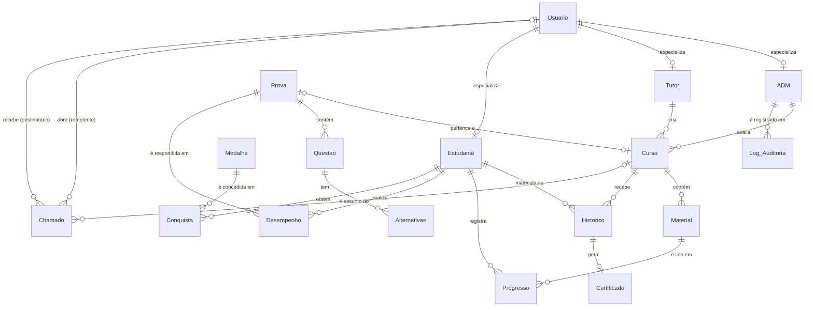

# Banco de Dados — Tech Quest (PIM IV)

Banco relacional **TechQuestDB**, hospedado no **Azure SQL Database** (região Brazil South), consumido exclusivamente pela API REST (`BackEnd/TechQuest.API`). Nenhum cliente (Web, Desktop, Mobile) acessa o banco diretamente.

| Item | Valor |
| :--- | :--- |
| SGBD | Microsoft SQL Server (Azure SQL Database, PaaS, tier serverless) |
| Banco | `TechQuestDB` |
| Collation | `SQL_Latin1_General_CP1_CI_AS` (não diferencia maiúsculas, **diferencia acentos**) |
| Objetos | 17 tabelas · 1 trigger · 1 stored procedure · 1 índice não clusterizado |
| Acesso pela aplicação | Entity Framework Core 8 (`TechQuestDbContext`), com `EnableRetryOnFailure` |

---

## Sumário

1. [Estrutura da pasta](#1-estrutura-da-pasta)
2. [Como criar o banco](#2-como-criar-o-banco)
3. [Convenções](#3-convenções)
4. [Diagrama de relacionamentos](#4-diagrama-de-relacionamentos)
5. [Dicionário de dados](#5-dicionário-de-dados)
6. [Domínios de valores](#6-domínios-de-valores)
7. [Objetos programáveis](#7-objetos-programáveis)
8. [Índices](#8-índices)
9. [Dados de demonstração](#9-dados-de-demonstração)
10. [Evolução em relação ao PIM III](#10-evolução-em-relação-ao-pim-iii)
11. [Limitações conhecidas](#11-limitações-conhecidas)

---

## 1. Estrutura da pasta

```
SQL/
├── README.md                        ← este arquivo (dicionário de dados)
├── Base Pim 3/
│   └── script.sql                   ← script original do PIM III (registro histórico, NÃO usar para criar o banco)
└── BD Pim 4/
    ├── 01_estrutura.sql             ← cria o banco completo do zero (tabelas, trigger, procedure, índice)
    └── 02_dados_demonstracao.sql    ← carga de demonstração (usuários, medalhas, cursos, provas)
```

O `01_estrutura.sql` representa o **esquema atual**. A lista de colunas dele foi extraída do mapeamento Fluent API do `TechQuestDbContext`, que é o contrato entre a aplicação e o banco.

---

## 2. Como criar o banco

**SQL Server local / SSMS / Azure Data Studio**

1. Execute `BD Pim 4/01_estrutura.sql` inteiro.
2. Execute `BD Pim 4/02_dados_demonstracao.sql`.

**Portal do Azure (editor de consultas)**

O editor do portal não aceita `GO`, `CREATE DATABASE` nem `USE`.

1. Crie o banco `TechQuestDB` pelo portal.
2. Abra o editor de consultas já conectado ao banco.
3. Cole o `01_estrutura.sql` **a partir da Seção 2**, removendo as linhas `GO`.
4. Execute o `02_dados_demonstracao.sql`.

**Conferência**

O final do `01_estrutura.sql` compara as colunas do banco com as que a API espera. O resultado esperado é **nenhuma linha "FALTANDO"**, 17 tabelas, 1 trigger e 1 procedure. O `02` é idempotente (só insere em tabela vazia) e termina com uma contagem por tabela e uma checagem de acentuação.

> ⚠️ Não rode o `01_estrutura.sql` no banco que já está em produção: ele é para criar um banco novo.

---

## 3. Convenções

| Convenção | Exemplo | Observação |
| :--- | :--- | :--- |
| Chave primária | `ID_<Tabela>` | `INT IDENTITY(1,1)`, constraint `PK_<Tabela>` |
| Chave estrangeira | `ID_<TabelaReferenciada>` | constraint `FK_<Tabela>_<Referência>` |
| Colunas | `Nome_Entidade` em PascalCase com `_` | `Nome_Curso`, `Data_Abertura` |
| Datas com hora | `DATETIME`, padrão `GETDATE()` | a API grava em UTC |
| Booleanos | `BIT` | `1` = verdadeiro |
| Texto com acento/código longo | `NVARCHAR(MAX)` | usado em `Material.Conteudo` |

Legenda das tabelas abaixo: **PK** chave primária · **FK** chave estrangeira · **UQ** único · **NN** não nulo.

---

## 4. Diagrama de relacionamentos



O diagrama completo, com tipos e chaves, está no DER do arquivo `Diagramas/DiagramasUML.asta`.

---

## 5. Dicionário de dados

### 5.1 Usuários e papéis

#### `Usuario`
Dados comuns a todas as contas. O **papel não é uma coluna**: ele é definido pela existência de registro em `ADM`, `Tutor` ou `Estudante`.

| Coluna | Tipo | Restrições | Padrão | Descrição |
| :--- | :--- | :--- | :--- | :--- |
| `ID_Usuario` | INT IDENTITY | PK, NN | — | Identificador do usuário |
| `Nome_Usuario` | VARCHAR(100) | NN | — | Nome completo |
| `Email_Usuario` | VARCHAR(100) | UQ | — | E-mail de login, gravado em minúsculas |
| `Senha_Usuario` | VARCHAR(255) | — | — | **Hash BCrypt** (60 caracteres; a folga permite trocar o algoritmo). A senha em texto nunca é gravada |
| `Data_Cadastro` | DATETIME | — | `GETDATE()` | Data de criação da conta |
| `Status_Usuario` | BIT | — | `1` | `1` ativa, `0` inativa. Contas não são excluídas, só desativadas |
| `Telefone_Usuario` | VARCHAR(20) | — | — | Telefone de contato (opcional) |
| `Data_Nascimento` | DATE | — | — | Data de nascimento (opcional) |
| `Cidade_Usuario` | VARCHAR(100) | — | — | Cidade (opcional) |

#### `ADM`
| Coluna | Tipo | Restrições | Descrição |
| :--- | :--- | :--- | :--- |
| `ID_ADM` | INT IDENTITY | PK, NN | Identificador do administrador |
| `ID_Usuario` | INT | FK → `Usuario`, NN | Conta do administrador |

#### `Tutor`
| Coluna | Tipo | Restrições | Descrição |
| :--- | :--- | :--- | :--- |
| `ID_Tutor` | INT IDENTITY | PK, NN | Identificador do tutor |
| `ID_Usuario` | INT | FK → `Usuario`, NN | Conta do tutor |

#### `Estudante`
| Coluna | Tipo | Restrições | Descrição |
| :--- | :--- | :--- | :--- |
| `ID_Estudante` | INT IDENTITY | PK, NN | Identificador do estudante |
| `ID_Usuario` | INT | FK → `Usuario`, NN | Conta do estudante |

### 5.2 Cursos e conteúdo

#### `Curso`
| Coluna | Tipo | Restrições | Padrão | Descrição |
| :--- | :--- | :--- | :--- | :--- |
| `ID_Curso` | INT IDENTITY | PK, NN | — | Identificador do curso |
| `Nome_Curso` | VARCHAR(150) | NN | — | Nome do curso |
| `Descricao_Curso` | VARCHAR(500) | — | — | Descrição exibida no catálogo |
| `Categoria_Curso` | VARCHAR(50) | — | — | Categoria (ex.: Programação) |
| `Nivel_Curso` | VARCHAR(30) | — | — | Nível (ex.: Iniciante) |
| `Duracao_Horas` | INT | — | — | Carga horária, exibida no certificado |
| `ID_Tutor_Criou` | INT | FK → `Tutor` | — | Tutor autor do curso |
| `ID_ADM_Avaliou` | INT | FK → `ADM` | — | Administrador que aprovou ou rejeitou |
| `ID_Prova` | INT | FK → `Prova` | — | Prova do curso (opcional; no máximo uma) |
| `Status_Curso` | VARCHAR(30) | — | `'Rascunho'` | Situação no fluxo de publicação (ver [6](#6-domínios-de-valores)) |

#### `Material`
| Coluna | Tipo | Restrições | Descrição |
| :--- | :--- | :--- | :--- |
| `ID_Material` | INT IDENTITY | PK, NN | Identificador da aula |
| `ID_Curso` | INT | FK → `Curso`, NN | Curso ao qual a aula pertence |
| `Titulo_Material` | VARCHAR(150) | — | Título da aula |
| `Tipo_Material` | VARCHAR(50) | — | `texto` ou `exercicio` |
| `Conteudo` | NVARCHAR(MAX) | — | Texto da aula, com acentuação e blocos de código |

### 5.3 Avaliação

#### `Prova`
| Coluna | Tipo | Restrições | Padrão | Descrição |
| :--- | :--- | :--- | :--- | :--- |
| `ID_Prova` | INT IDENTITY | PK, NN | — | Identificador da prova |
| `Titulo_Prova` | VARCHAR(100) | — | — | Título da prova |
| `Nota_Minima` | DECIMAL(4,2) | NN | `7.00` | Nota mínima para aprovação (0 a 10) |
| `Tempo_Minutos` | INT | NN | `30` | Tempo para responder |

#### `Questao`
| Coluna | Tipo | Restrições | Padrão | Descrição |
| :--- | :--- | :--- | :--- | :--- |
| `ID_Questao` | INT IDENTITY | PK, NN | — | Identificador da questão |
| `ID_Prova` | INT | FK → `Prova`, NN | — | Prova à qual pertence |
| `Enunciado` | VARCHAR(MAX) | NN | — | Texto da pergunta |
| `Codigo_Exemplo` | VARCHAR(MAX) | — | — | Bloco de código exibido junto do enunciado |
| `Ordem_Questao` | INT | NN | `1` | Posição na prova |

#### `Alternativas`
| Coluna | Tipo | Restrições | Padrão | Descrição |
| :--- | :--- | :--- | :--- | :--- |
| `ID_Alternativa` | INT IDENTITY | PK, NN | — | Identificador da alternativa |
| `ID_Questao` | INT | FK → `Questao`, NN | — | Questão à qual pertence |
| `Letra_Alternativa` | CHAR(1) | — | — | Letra (A, B, C...) |
| `Texto_Alternativa` | VARCHAR(500) | — | — | Texto da alternativa |
| `Eh_Correta` | BIT | — | `0` | **Gabarito.** Nunca é enviado ao estudante; a correção é feita na API |

### 5.4 Acompanhamento do estudante

#### `Historico`
Representa a **matrícula** e a conclusão do curso.

| Coluna | Tipo | Restrições | Descrição |
| :--- | :--- | :--- | :--- |
| `ID_Historico` | INT IDENTITY | PK, NN | Identificador da matrícula |
| `ID_Estudante` | INT | FK → `Estudante`, NN | Estudante |
| `ID_Curso` | INT | FK → `Curso`, NN | Curso |
| `Status_Conclusao` | VARCHAR(20) | — | `Em andamento` ou `Concluido` |
| `Data_Conclusao` | DATE | — | Data em que o curso foi concluído |

#### `Progresso`
Uma linha por estudante e material.

| Coluna | Tipo | Restrições | Padrão | Descrição |
| :--- | :--- | :--- | :--- | :--- |
| `ID_Progresso` | INT IDENTITY | PK, NN | — | Identificador |
| `ID_Estudante` | INT | FK → `Estudante`, NN | — | Estudante |
| `ID_Material` | INT | FK → `Material`, NN | — | Aula |
| `Status_Conclusao` | BIT | — | `0` | `1` = aula concluída |
| `Data_Visualizacao` | DATETIME | — | `GETDATE()` | Último acesso à aula |
| `Porcentagem_Assistida` | INT | — | `0` | Percentual lido (0 a 100). Nunca diminui |

#### `Desempenho`
**Uma linha por tentativa** de prova. Não existe "nota final" gravada.

| Coluna | Tipo | Restrições | Padrão | Descrição |
| :--- | :--- | :--- | :--- | :--- |
| `ID_Desempenho` | INT IDENTITY | PK, NN | — | Identificador |
| `ID_Estudante` | INT | FK → `Estudante`, NN | — | Estudante |
| `ID_Prova` | INT | FK → `Prova`, NN | — | Prova |
| `Nota` | DECIMAL(5,2) | — | — | Nota da tentativa (0 a 10, duas casas) |
| `Data_Realizacao` | DATETIME | — | `GETDATE()` | Data da tentativa |
| `Tentativas` | INT | — | `1` | Número desta tentativa (1ª, 2ª...) |

#### `Certificado`
| Coluna | Tipo | Restrições | Padrão | Descrição |
| :--- | :--- | :--- | :--- | :--- |
| `ID_Certificado` | INT IDENTITY | PK, NN | — | Identificador |
| `ID_Historico` | INT | FK → `Historico`, NN | — | Matrícula concluída que originou o certificado |
| `Codigo_Autenticacao` | UNIQUEIDENTIFIER | — | `NEWID()` | Código público de validação, gerado **pelo banco** |
| `Data_Emissao` | DATETIME | — | `GETDATE()` | Data de emissão |

### 5.5 Gamificação

#### `Medalha`
| Coluna | Tipo | Restrições | Descrição |
| :--- | :--- | :--- | :--- |
| `ID_Medalha` | INT IDENTITY | PK, NN | Identificador |
| `Nome_Medalha` | VARCHAR(50) | NN | Nome. **As medalhas automáticas são localizadas pelo nome** (ver [11](#11-limitações-conhecidas)) |
| `Raridade` | VARCHAR(20) | — | `comum`, `raro`, `épico` ou `lendário` |
| `Descricao_Medalha` | VARCHAR(200) | — | Critério exibido ao estudante |

#### `Conquista`
| Coluna | Tipo | Restrições | Padrão | Descrição |
| :--- | :--- | :--- | :--- | :--- |
| `ID_Conquista` | INT IDENTITY | PK, NN | — | Identificador |
| `ID_Estudante` | INT | FK → `Estudante`, NN | — | Estudante |
| `ID_Medalha` | INT | FK → `Medalha`, NN | — | Medalha obtida |
| `Data_Conquista` | DATETIME | — | `GETDATE()` | Data da conquista |

> Não existem colunas de XP ou nível: esses valores são **calculados** a partir de `Progresso`, `Desempenho` e `Conquista` (ver `Docs/README.md`, ADR-007).

### 5.6 Suporte e auditoria

#### `Chamado`
| Coluna | Tipo | Restrições | Padrão | Descrição |
| :--- | :--- | :--- | :--- | :--- |
| `ID_Chamado` | INT IDENTITY | PK, NN | — | Identificador |
| `ID_Remetente` | INT | FK → `Usuario`, NN | — | Quem abriu |
| `ID_Destinatario` | INT | FK → `Usuario` | — | Quem deve responder. **Nulo nos chamados técnicos**, para qualquer administrador assumir |
| `ID_Curso` | INT | FK → `Curso` | — | Curso da dúvida (nulo nos chamados técnicos) |
| `Tipo_Chamado` | VARCHAR(20) | — | — | `Duvida`, `Tecnico` ou `Avaliacao` |
| `Assunto` | VARCHAR(100) | — | — | Assunto |
| `Descricao` | VARCHAR(MAX) | — | — | Texto do chamado ou da resposta |
| `Data_Abertura` | DATETIME | — | `GETDATE()` | Data de abertura |
| `Status_Chamado` | VARCHAR(20) | — | `'Aberto'` | `Aberto`, `Em andamento` ou `Resolvido` |

#### `Log_Auditoria`
| Coluna | Tipo | Restrições | Padrão | Descrição |
| :--- | :--- | :--- | :--- | :--- |
| `ID_Log` | INT IDENTITY | PK, NN | — | Identificador |
| `ID_ADM` | INT | FK → `ADM`, NN | — | Administrador associado à ação |
| `Acao_Realizada` | VARCHAR(255) | — | — | Descrição da ação |
| `Data_Acao` | DATETIME | — | `GETDATE()` | Data da ação |

---

## 6. Domínios de valores

O SQL Server não restringe estes campos (são `VARCHAR`). Os valores válidos são garantidos pelas regras da camada de domínio e de aplicação da API.

| Coluna | Valores válidos | Onde a regra está |
| :--- | :--- | :--- |
| `Curso.Status_Curso` | `Rascunho` → `Pendente` → `Publicado`; `Pendente` → `Rejeitado` → `Pendente` | `FluxoPublicacaoCurso` (Domain) |
| `Material.Tipo_Material` | `texto`, `exercicio` | Opções do editor do tutor (Web e Mobile); a API não valida o valor |
| `Historico.Status_Conclusao` | `Em andamento`, `Concluido` | `ProgressoService`, `ConclusaoCursoService` |
| `Chamado.Tipo_Chamado` | `Duvida` (para o tutor), `Tecnico` (para os admins), `Avaliacao` (motivo de rejeição de curso) | `ChamadoService`, `AdminService` |
| `Chamado.Status_Chamado` | `Aberto`, `Em andamento`, `Resolvido` | `ChamadoService` |
| `Medalha.Raridade` | `comum`, `raro`, `épico`, `lendário` | Catálogo |
| `Usuario.Status_Usuario` | `1` ativa, `0` inativa | `AdminService`, `ContaService` |

---

## 7. Objetos programáveis

### Trigger `TRG_Auditoria_StatusUsuario`

| Item | Valor |
| :--- | :--- |
| Tabela | `Usuario` |
| Evento | `AFTER UPDATE`, quando `Status_Usuario` muda |
| Efeito | Insere em `Log_Auditoria` a frase `Status do Usuario ID <id> alterado para: <0/1>` |
| Requisito | RF11 (auditar ações) |

**Atenção:** como a tabela `Usuario` tem trigger, o mapeamento do Entity Framework declara `HasTrigger()`. A partir do EF Core 7, os comandos de escrita usam a cláusula `OUTPUT`, que o SQL Server não aceita em tabelas com trigger.

### Procedure `SP_RelatorioDesempenhoEstudante`

| Item | Valor |
| :--- | :--- |
| Parâmetro | `@ID_Estudante INT` |
| Retorno | Estudante, Prova, Nota, Tentativas, Data_Realizacao (mais recente primeiro) |
| Uso | Tela "Minhas provas" (Web e Mobile), rota `GET /api/perfil/desempenho` |
| Chamada | `FromSqlInterpolated` (parametrizada, sem SQL Injection), resultado em tipo `[Keyless]` |
| Requisito | RF12 (relatórios de desempenho) |

---

## 8. Índices

Além dos índices criados automaticamente pelas chaves primárias e pela restrição `UNIQUE` do e-mail:

| Índice | Tabela (coluna) | Motivo |
| :--- | :--- | :--- |
| `IX_Chamado_Curso` | `Chamado (ID_Curso)` | Consulta "chamados deste curso" no painel do tutor |

---

## 9. Dados de demonstração

O `02_dados_demonstracao.sql` cria:

| Conteúdo | Detalhe |
| :--- | :--- |
| 3 usuários | Felipe Almeida (estudante) `felipe123@gmail.com` / `aluno123@` · Ana Souza (tutora) `tutor123@gmail.com` / `tutor123@` · Carlos Mendes (admin) `admin123@gmail.com` / `admin123@` |
| 12 medalhas | 8 automáticas (Primeiro Passo, Estudante Dedicado, Bibliotecário, Quiz Champion, Pontuação Perfeita, Mestre em C#, DBA Iniciante, Lenda da Tech Quest) e 4 concedidas pelo tutor (Mestre em Arrays, Maratonista, POO Master, Arquiteto SOLID) |
| 2 cursos publicados | Fundamentos de C# · Banco de Dados e Modelagem de Sistemas |
| 11 materiais | Aulas de texto e exercício dos dois cursos |
| 2 provas | Nota mínima 7,00 e 30 minutos cada |
| 18 questões | Cada uma com alternativas e exatamente uma correta |

As senhas estão gravadas como hashes BCrypt reais (fator 11).

---

## 10. Evolução em relação ao PIM III

O modelo do PIM III foi **preservado**. Toda mudança entrou como acréscimo (`ALTER TABLE ... ADD`), sem remover ou alterar o que já existia.

| Tabela | O que foi acrescentado no PIM IV | Motivo |
| :--- | :--- | :--- |
| `Usuario` | `Telefone_Usuario`, `Data_Nascimento`, `Cidade_Usuario` | Tela de edição de perfil |
| `Curso` | `Descricao_Curso`, `Categoria_Curso`, `Nivel_Curso`, `Duracao_Horas` | Catálogo e certificado |
| `Material` | `Conteudo` | O texto da aula passou a vir do banco, e não do HTML |
| `Prova` | `Nota_Minima`, `Tempo_Minutos` | A nota de corte é dado do modelo, e não constante no código |
| `Questao` | `Codigo_Exemplo`, `Ordem_Questao` | Questões com código e ordem definida |
| `Alternativas` | `Letra_Alternativa` | Correção por letra |
| `Medalha` | `Descricao_Medalha` | Critério exibido ao aluno |
| `Chamado` | `ID_Curso` + `IX_Chamado_Curso` | Encaminhar a dúvida ao tutor do curso |

---

## 11. Limitações conhecidas

| Limitação | Impacto | Solução mapeada |
| :--- | :--- | :--- |
| A trigger grava `ID_ADM = 1` fixo | O log não identifica qual administrador alterou o status | Usar `SESSION_CONTEXT`, com a API gravando o id do admin antes do `UPDATE` |
| Status em `VARCHAR` sem `CHECK` | O banco aceitaria um valor inválido inserido manualmente | Regras garantidas na API; `CHECK constraints` como melhoria |
| Medalhas automáticas localizadas pelo nome | Renomear uma delas (inclusive o acento) desliga a concessão | O Desktop bloqueia a renomeação das 8 automáticas |
| Collation sensível a acento | Busca por "Joao" não encontra "João" | Aplicar `COLLATE ... AI` nas buscas, se necessário |
| Tier serverless com auto-pause | A primeira consulta após pausa demora dezenas de segundos | `EnableRetryOnFailure` na API e timeouts de 45 a 60 s nos clientes |
